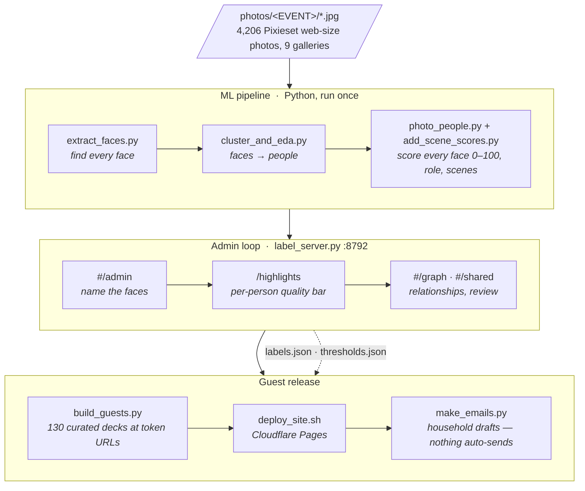

# Wedding Wrapped

**Every guest gets a personal photo recap.** Built for Preethi & Neel's wedding weekend (Atlanta, April 24–25, 2026): face recognition finds each guest in ~4,200 professional photos, picks their best shots, and builds a private page for every household.

**The problem:** a photographer delivers one huge gallery (here, 4,206 photos across 9 events). Guests won't scroll through thousands of photos to find the few they're in, couples can't hand-sort them for 140 people, and sending everyone everything ignores whose photos are whose. Wedding Wrapped turns that one gallery into a short, private recap for each household.

- **Try the demo:** https://neelnaik99.github.io/wedding-wrapped/demo/ (one real household's page layout with made-up names and drawn stand-ins for the photos)
- **Live site:** https://photos.preethiandneel.com (asks for a guest's email, so it only works for people who were at the wedding)

| | |
|---|---|
| Photos | 4,206 across 9 events |
| Faces detected | 26,350, clustered into 140 named guests |
| Pages | one per household, 72 in all |
| Hosting | $0/month, static files on Cloudflare Pages |

**What's interesting here**
- **ML pipeline:** InsightFace embeddings, agglomerative clustering into people, per-face quality scores (eyes open, smile, sharpness) with a quality bar fitted to each guest, scene de-duplication, and friend groups found with Louvain community detection on who appears together.
- **Privacy by construction:** a household's page only contains photos that include one of its members or just the couple, and the rule is re-checked from disk on every deploy. The deploy also fails if any public file holds an email address, a guest ID or another guest's link. See [docs/VISIBILITY.md](docs/VISIBILITY.md).
- **Login without accounts:** guests type their email and a Cloudflare Pages Function emails them their household's link. Every request gets the same answer, so the site never reveals who is a guest. See [docs/adr/0001-login-mails-existing-links.md](docs/adr/0001-login-mails-existing-links.md).
- **One React bundle, two jobs:** the same build is the local admin app (name people, tune quality bars, preview any page) and the static guest page.
- **Product thinking:** decision records in [docs/adr/](docs/adr/), a roadmap in [docs/ROADMAP.md](docs/ROADMAP.md), and lessons from the data in [docs/FINDINGS.md](docs/FINDINGS.md).

> This is a public copy of a private repo. Guest names, photos, face data and contact details were never committed, and names that appeared in code and tests have been replaced with made-up ones. The demo data was generated by anonymizing one household's built page.

## How it was built

The repo takes the professional photos from the weekend (9 events, Pixieset web-size downloads), finds every face, clusters faces into people, scores every photo of every person, and builds a private "Wedding Wrapped" page per household (hero shot, stats, timeline, co-stars and ~25 curated highlights), deployed to Cloudflare Pages at unguessable URLs. Nothing is ever auto-sent; every step that touches guests has a human review gate.

Full docs live in [`docs/`](docs/):

| Doc | Covers |
|---|---|
| [docs/ARCHITECTURE.md](docs/ARCHITECTURE.md) | Data flow, every file in `data/`, app modes, ports, PII policy |
| [docs/PIPELINE.md](docs/PIPELINE.md) | Per-script reference: inputs, outputs, flags, runtimes, tuning knobs |
| [docs/ADMIN.md](docs/ADMIN.md) | The admin app: naming, graph, shared photos, thresholds, undo/backup |
| [docs/DEPLOY.md](docs/DEPLOY.md) | Cloudflare Pages deploy, limits, rollback, single-guest rebuild |
| [docs/SEND.md](docs/SEND.md) | Tokens, email drafts, sending options, rotation, what guests can see |

## Architecture



## Quickstart: full rebuild from photos

Prereqs: `photos/<EVENT NAME>/*.jpg` folders (one per gallery), the Python venv at `.venv/`
(insightface, opencv, pandas, scikit-learn, networkx, imagehash, Pillow, tqdm), and the guest
list CSV at `~/Downloads/guest-list.csv` (columns: `first name`, `last name`, `email`, `party`,
`envelope name`, `phone number`, plus per-event RSVP columns).

```bash
cd ~/Downloads/wedding-wrapped

# 1. Faces + embeddings (incremental — skips already-processed photos). ~1.76 s/photo on M1.
.venv/bin/python extract_faces.py photos/*

# 2. Cluster into people + EDA report (seconds–minutes)
.venv/bin/python cluster_and_eda.py --top 150
open data/eda_report.html          # eyeball cluster purity

# 3. Per-photo features (phash, sharpness) — a few minutes
.venv/bin/python photo_features.py

# 4. Per-face quality scoring (landmarks are cached; first run ~36 min)
.venv/bin/python photo_people.py

# 5. 0-100 scores + scenes + auto thresholds (seconds; MUST run from repo root)
.venv/bin/python add_scene_scores.py

# 6. Relationship graph (optional standalone HTML; the server rebuilds it on demand)
.venv/bin/python relationship_graph.py 50
```

Steps 1–2 are also wrapped as `./run_eda.sh photos/*`.

## The admin loop: label → thresholds → build → deploy → email

```bash
# 1. LABEL — start the admin server, name every cluster (works from a phone on the LAN)
.venv/bin/python label_server.py --min 15        # → http://localhost:8792/#/admin

# 2. THRESHOLDS — review each person's curated picks, drag their quality bar
open http://localhost:8792/highlights

# 3. BUILD — one deck per labeled guest, then verify
.venv/bin/python build_guests.py --base-url https://wedding-wrapped.pages.dev --check

# 4. DEPLOY — safety checks + Cloudflare Pages (one-time: npx wrangler login)
./deploy_site.sh

# 5. EMAIL — per-household drafts (review, then send manually; see docs/SEND.md)
.venv/bin/python make_emails.py --base-url https://wedding-wrapped.pages.dev
```

Rebuilding the React admin/deck app (only needed after editing `app/src`):

```bash
cd app && bash <web-artifacts-builder-skill>/scripts/bundle-artifact.sh   # → app/bundle.html
cd .. && ./deploy_bundle.sh                                              # refresh admin drafts in site/
```

`bundle-artifact.sh` is the Claude web-artifacts-builder skill script (Parcel build +
`html-inline` into a single `bundle.html`); any equivalent single-file bundling works.

## Repo map

| Path | What |
|---|---|
| `extract_faces.py` | Step 1 — detect faces + embeddings, build `cache/` |
| `cluster_and_eda.py` | Step 2 — cluster faces into people, EDA report |
| `photo_features.py` | Step 3 — per-photo phash + sharpness |
| `photo_people.py` | Step 4 — per-face look score, role, legacy highlights |
| `add_scene_scores.py` | Step 5 — 0-100 score, scene ids, auto thresholds |
| `relationship_graph.py` | Who-with-whom graph; `build()` reused by the server |
| `curation.py` | Shared highlight-picking logic (server + builders) |
| `label_server.py` | Admin server on :8792 — all APIs + serves the SPA |
| `app/` | React SPA source (admin views + guest deck); builds to `app/bundle.html` |
| `build_wrapped.py` | Build one person's deck (`build()` importable) |
| `build_top.py` | Batch-build admin draft decks into `site/` |
| `build_guests.py` | Build the deployable guest site into `site_guest/` |
| `deploy_bundle.sh` | Copy a rebuilt `bundle.html` over the admin drafts in `site/` |
| `deploy_site.sh` | Checks + `wrangler pages deploy` of `site_guest/` |
| `make_emails.py` | Per-household email drafts (nothing sent) |
| `run_eda.sh` | Steps 1–2 in one command |
| `label_ui.html`, `people_ui.html`, `highlights_ui.html` | Legacy/standalone admin pages (`/namer`, `/people`, `/highlights`) |
| `experiments/` | Curation strategy A/B experiment (offline) |
| `data/` | All derived data — see [docs/ARCHITECTURE.md](docs/ARCHITECTURE.md) |
| `photos/`, `cache/`, `site/`, `site_guest/` | Large binaries — all gitignored |
