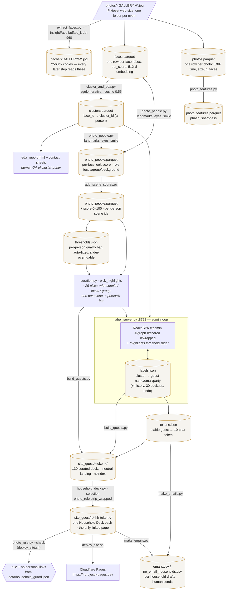

# Architecture

## Data flow



Current scale (2026-08): 4,206 photos across 9 galleries, 26,350 detected faces,
2,910 clusters, 140 labeled guests → 130 guest decks (~3,100 files, ~450 MB).

## Every file in `data/`

"Tracked" = committed to git. Everything untracked is either PII or rebuildable from `photos/`.

| File | Producer | Consumer(s) | PII | Tracked |
|---|---|---|---|---|
| `photos.parquet` | extract_faces.py | everything downstream | photos of people | no |
| `faces.parquet` | extract_faces.py | cluster_and_eda, photo_people, label_server, builders | biometric embeddings | no |
| `clusters.parquet` | cluster_and_eda.py | photo_people, label_server, builders, relationship_graph | face→person mapping | no |
| `people_stats.csv` | cluster_and_eda.py | label_server (queue), build_top | per-person counts | no |
| `event_stats.csv`, `people_by_event.csv` | cluster_and_eda.py | human EDA only | aggregate | no |
| `eda_report.html`, `contact/<cid>.jpg` | cluster_and_eda.py | human QA (cluster purity) | face crops | no |
| `photo_features.parquet` | photo_features.py | photo_people, build_wrapped | no (hashes/sharpness) | no |
| `photo_people.parquet` | photo_people.py (+cols from add_scene_scores.py) | curation, label_server, build_guests | per-person photo index | no |
| `face_expr.json`, `expr_cache.json` | photo_people.py (landmark cache) | photo_people rerun | derived facial metrics | no |
| `highlights.json` | photo_people.py (legacy picker) | superseded by curation.py | picks per person | no |
| `thresholds.json` | add_scene_scores.py auto-fit; label_server `/api/threshold` | curation.pick_highlights | **no** — `{cid: {value, auto}}` tuning state | **yes** |
| `exclude.json` | hand-edited (list of cluster ids, e.g. `[540]`) | photo_people, label_server, build_top, relationship_graph | **no** — anonymous cluster ids | **yes** |
| `labels.json` | label_server (UI writes) | every builder, relationship_graph | **names, emails, party ids** | no |
| `labels_history.jsonl` | label_server (append per change) | `/api/undo`, `/api/history` | same as labels | no |
| `backups/labels-*.json` | label_server (startup snapshot, keeps 30) | manual restore | same as labels | no |
| `crops/` | label_server `/crop/` endpoint (on demand) | admin UI face thumbs | face crops | no |
| `tokens.json` | build_guests.py | build_guests (stability), make_emails via manifest | guest→URL map | no |
| `households.json` | build_guests.py | make_emails.py, Login map | names, tokens, URLs | no |
| `household_guard.json` | build_guests.py | `photo_rule.py --check` (deploy_site.sh) | household token → cluster ids, couple ids | no |
| `send_manifest.json` | build_guests.py | make_emails.py | names, emails, tokens | no |
| `emails.csv` / `emails.json` | make_emails.py | manual sending / mail merge | names, emails, links | no |
| `no_email_households.csv` | make_emails.py | manual texting | names, phones | no |
| `relationship_graph.html`, `relationship_communities.csv` | relationship_graph.py | human EDA | names once labeled | no |

**Why `thresholds.json` and `exclude.json` ARE tracked:** they are the only hand-tuned state
in `data/` that contains no personal data — just anonymous cluster ids and numeric cut-offs.
Losing them would silently change which photos every guest receives (a re-run of
`add_scene_scores.py` preserves manual thresholds only if the file exists), so they live in git.
Everything else in `data/` is either mechanically rebuildable from `photos/` or contains
names/emails/embeddings/face crops and is excluded by `.gitignore`.

## The two app modes

One React bundle (`app/bundle.html`, source in `app/src/`) serves two very different jobs.
`app/src/App.tsx` decides by **pathname** at load time:

```ts
function isUnifiedMode(): boolean {
  const p = location.pathname
  if (p === "/" || p === "") return true
  return /^\/(admin|wrapped|shared|graph|app)(\/|$)/.test(p)
}
```

- **Standalone deck mode** — the same `bundle.html` is copied to
  `site/<slug>/index.html` and `site_guest/<token>/index.html`. Pathname is
  `/<slug-or-token>/`, so `isUnifiedMode()` is false and the app renders `<Deck />`, which
  fetches `./wrapped.json` sitting next to it. Zero server dependencies — works on any static
  host. This is exactly what guests see.
- **Unified admin mode** — `label_server.py` serves the same bundle at `/`, `/admin`,
  `/wrapped…`, `/shared…`, `/graph…`, `/app…`. The app becomes a hash-routed SPA
  (`app/src/router.ts`: `#/admin`, `#/graph`, `#/wrapped/:slug`, `#/shared?cids=15,50`) over
  the server's `/api/*` endpoints, with admin extras layered onto the deck (right-click naming,
  face boxes in the lightbox). Deck previews load `/site/<slug>/wrapped.json` through the server.

Route state (filter, search, open cluster, graph selection) lives in the hash query so deep
links and back/forward work under any server path.

One switch: `label_server.py` serves the SPA at `/` only when **both** `app/bundle.html` and the
marker file `app/.unified` exist; otherwise `/` falls back to the legacy `label_ui.html`.

## Ports

| Port | What | How |
|---|---|---|
| 8792 | Admin server (APIs + SPA + legacy pages + `/cache/`, `/crop/`, `/site/` image serving) | `.venv/bin/python label_server.py --min 15` (binds 0.0.0.0 — reachable from phones on the LAN) |
| 8791 | Dumb static preview of `site/` (what a draft deck looks like with no server) | `python3 -m http.server 8791 --directory site` (also `.claude/launch.json` → `wrapped-site`) |

`site_guest/` can be previewed the same way (`python3 -m http.server 8791 --directory site_guest`),
but the real check is the Cloudflare preview URL printed by `deploy_site.sh`.


## Groups, explorers & visibility (added 2026-08)

- `data/groups.json` — many-to-many person↔group (couple implicit in every group). Managed at
  /groups (standalone) and #/groups-admin (SPA); suggestions via `/api/group_suggest`
  (hub-resistant min-overlap affinity) and `/api/group_presets` (Louvain circles + mutual-best
  couples pass, typed by tightness × event profile).
- `build_guests.py` injects per-guest `groups` payloads into wrapped.json, each carrying a
  **per-member `map`** (`group_explorer.member_map_payload`) — the ego graph + combination
  photo finder, whose photo pool contains only viewer-inclusive photos. The deck renders it
  at the in-deck route `#/map` (`app/src/deck/GroupMap.tsx`).
- **One user-facing link.** A guest only ever receives their deck URL; the map, the all-photos
  view and the finder are hash routes inside it. No standalone explorer pages are deployed —
  `group_explorer.render_admin_explorer` survives only for label_server's local `/explore` EDA
  page, which renders the same shared payload and is never shipped to a guest.
  A cameo whose group carries a map is upgraded from the postcard to the full React deck
  (DESIGN.md's connection gate overriding the tier table) — the postcard cannot host a deck route.
- Visibility is three-layered (capability / relationship / quality) — see **docs/VISIBILITY.md**.
- Token namespace in `data/tokens.json`: `gid:<guest_id>` and `cluster:<cid>` (personal decks,
  10 chars) and `hh:<party>` (Household Decks at `/h/<token>/`, 10 chars). All gitignored; back
  it up. The retired `gx:<group_id>:<cid>` explorer namespace (`x`+10 chars) is pruned on build.
- **Household Decks** (`household.py`, `household_deck.py`, `selection`) — one Deck per Household
  at `/h/<token>/`, one-person Households included (docs/adr/0002). `household.hh_key` is imported
  by `make_emails.py` so the email and the Deck agree on membership. `household_deck` bundles each
  member's curated wrapped.json into `household.json` (+ per-member `pool-<cid>.json`), tags every
  photo with `who`, and precomputes counts for every member subset; the app's `selection` module
  turns the member picker into the Selection every section reads. `photo_rule` enforces the
  photo rule at build time and, via `python photo_rule.py --check`, again at deploy time. See
  docs/SEND.md.
